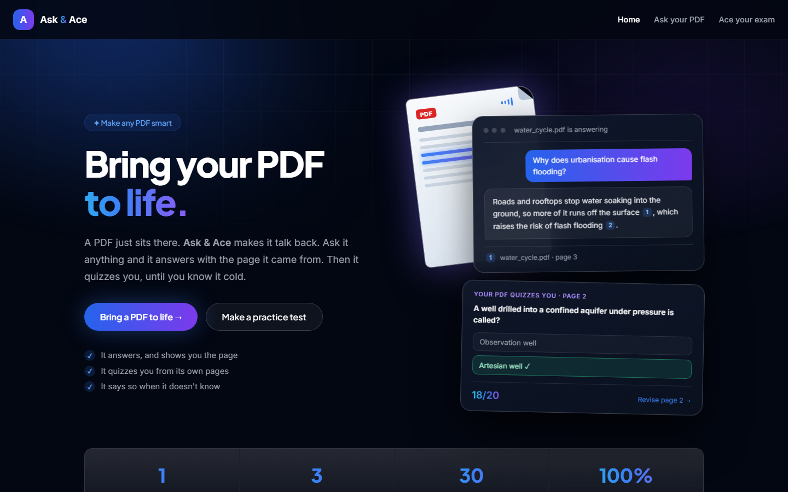
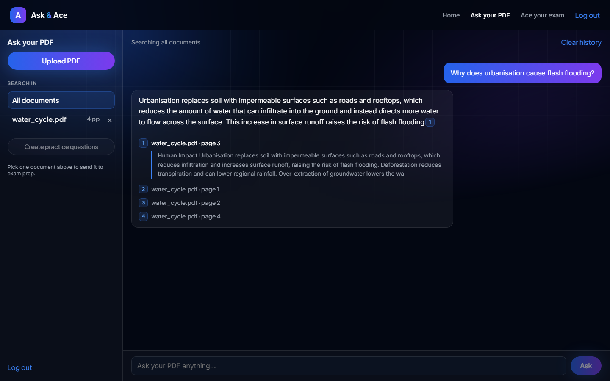
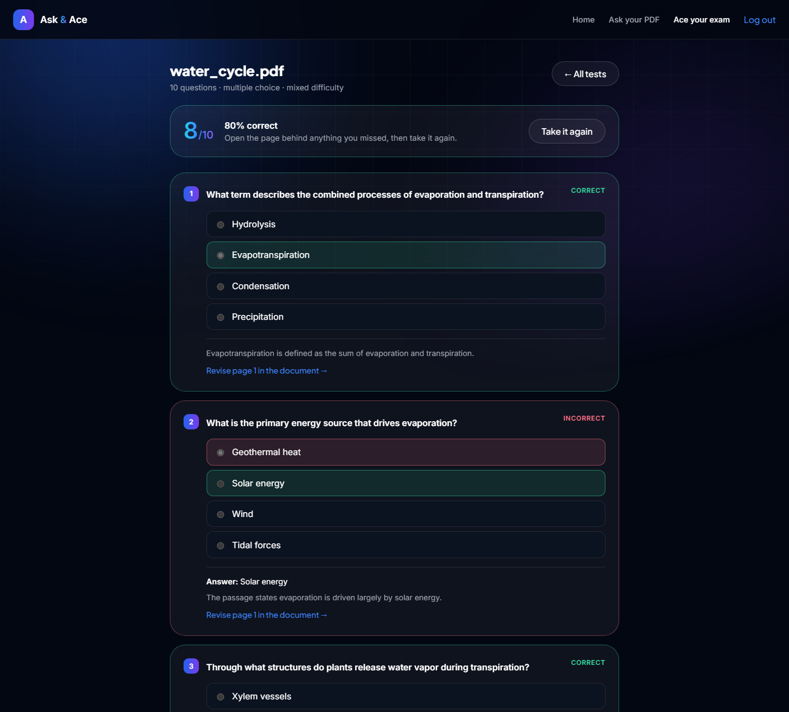
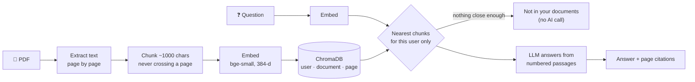
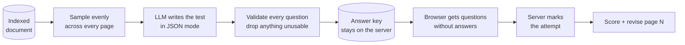

<div align="center">

# Ask & Ace

### Ask your PDF. Ace your exam.

**A PDF normally just sits there. Ask & Ace brings it to life:** upload one file, and it answers
your questions with the page it found them on, then writes you a practice test and marks it.

<br>


[](https://github.com/ankit2003A/Ask-Ace)

[Features](#-features) ·
[Screenshots](#-screenshots) ·
[Quick start](#-quick-start) ·
[How it works](#-how-it-works) ·
[API](#-api) ·
[Roadmap](#-roadmap)

<br>



</div>

<br>

## 💡 Why Ask & Ace?

Studying from a PDF usually means scrolling, Ctrl+F for words you *hope* are in there, and re-reading
everything the night before the exam with no idea what actually stuck.

|  | 📄 A plain PDF | ✨ The same PDF on Ask & Ace |
|---|---|---|
| **Finding things** | Scroll and hope, or Ctrl+F the exact words | Ask in your own words, get a direct answer |
| **Trusting it** | — | Every answer shows the page it came from |
| **Testing yourself** | Make your own flashcards | It writes a practice test from its own pages |
| **Revising** | Re-read all of it | It marks you and points to the exact page you missed |

The name is the product: **Ask** is one half, **Ace** is the other, and one upload powers both.

<br>

## ✨ Features

<table>
<tr>
<td width="50%" valign="top">

### 💬 Ask your PDF

- **Ask in plain language.** No exact keywords needed.
- **Page-level citations.** Every answer is numbered back to its sources; click one to read the exact
  passage on the exact page.
- **Says "I don't know".** If the answer isn't in your PDF, it says so instead of inventing one, and
  shows no misleading citations.
- **Answers only from your document.** No outside knowledge, so what you learn matches what you'll be
  examined on.
- **Handles small talk.** "Hi" or "thanks" gets a friendly reply without spending an AI call.

</td>
<td width="50%" valign="top">

### 🎯 Ace your exam

- **Tests from the whole document.** Questions are sampled evenly across it, not just from the
  opening pages.
- **Three question types:** multiple choice, true / false and short answer, or a mix.
- **Your difficulty, your length.** Easy to hard, 5 to 30 questions.
- **No peeking.** Questions reach the browser *without* their answers; the server marks your attempt
  and only then reveals the key.
- **Closes the loop.** Every wrong answer links straight back to the page to revise.

</td>
</tr>
</table>

**Also:** one account for both modules · move a PDF between them without re-uploading ·
a 143-page PDF indexes in about 6 seconds · dark UI.

<br>

## 📸 Screenshots

<table>
<tr>
<td width="50%" valign="top">

**Ask your PDF**: a real answer from the live model, with citation 1 opened to the exact passage on page 3.



</td>
<td width="50%" valign="top">

**Ace your exam**: a generated test, marked by the server. The missed question shows the right answer,
why, and the page to revise.



</td>
</tr>
</table>

<br>

## 🚀 Quick start

### Prerequisites

- **Python 3.11+**
- **Node.js 20.19+** (or 22.12+), which Vite 8 requires
- A free **Groq API key** from [console.groq.com](https://console.groq.com). Gemini or any
  OpenAI-compatible endpoint also works.

### 1. Backend

```bash
cd backend
python -m venv .venv

# macOS / Linux
source .venv/bin/activate
# Windows (PowerShell)
.venv\Scripts\Activate.ps1

pip install -r requirements-dev.txt
cp .env.example .env          # Windows: copy .env.example .env
```

Open `backend/.env` and set two values:

```ini
SECRET_KEY=<a long random string>   # python -c "import secrets; print(secrets.token_urlsafe(48))"
LLM_API_KEY=<your Groq key>
```

Then start the API:

```bash
uvicorn app.main:app_factory --factory      # → http://localhost:8000  (docs at /docs)
```

> **Note:** it's `app.main:app_factory --factory`, not `app.main:app`. The app is built by a factory
> so tests can inject fakes.

### 2. Frontend

In a second terminal:

```bash
cd frontend
cp .env.example .env          # Windows: copy .env.example .env
npm install
npm run dev                   # → http://localhost:5173
```

### 3. Bring a PDF to life

Open **http://localhost:5173**, register, and upload a text-based PDF. The first upload downloads the
embedding model (about **66 MB**) once; after that, indexing takes seconds.

<br>

## 🧠 How it works

### Ask: retrieval-augmented answers with citations



### Ace: tests that cover the whole document



### Design decisions worth knowing

- **Chunks never cross page boundaries**, so every chunk maps to exactly one page and citations are exact.
- **Tests don't reuse the retriever.** Nearest-neighbour search clusters on one topic; a test needs
  coverage, so chunks are sampled at an even stride across the whole document.
- **Model output is untrusted.** A multiple-choice question whose answer isn't among its own options
  can't be marked, so it's discarded, and the response says how many were dropped.
- **Requests are capped to what the document can carry.** Thirty questions about two paragraphs makes
  a model repeat itself or refuse, so the count scales with the available text.
- **Tenant isolation.** Every vector and row carries a user id and every query filters on it. Asking
  for another account's document returns `404`.
- **Prompt-injection stance.** Retrieved text is labelled as untrusted data in the system prompt. This
  reduces, but does not eliminate, the risk.
- **Provider-agnostic.** One small HTTP client talks to any OpenAI-compatible endpoint.

<br>

## ⚡ Performance

A **143-page, 3.7 MB PDF** (211 chunks) indexes in **about 6 seconds**: ~1 s to extract text and ~4.5 s
to embed. The server logs the breakdown for every upload:

```
INFO:     indexed Python Programming.pdf: 143 pages, 211 chunks, batch_size=1 | extract 1.05s, embed 4.45s
```

Getting there took two non-obvious fixes:

| Problem | Time | Cause | Fix |
|---|---|---|---|
| Slow on every upload | ~20 s | Batched texts are padded to the longest in the batch, so mixed prose and code wasted most of the compute | `EMBEDDING_BATCH_SIZE=1`. Vectors are identical (cosine similarity 1.000000) |
| Very slow while you used the browser | ~90 s | Windows 11 power-throttles windowless "background" processes onto efficiency cores | The server opts out of power throttling at startup ([`winperf.py`](backend/app/winperf.py)) |

> **Tip:** don't time uploads with `uvicorn --reload`. The file watcher restarts the worker and reloads
> the model, which makes indexing look far slower than it is.

<br>

## 🗂️ Project structure

```
Ask-Ace/
├── backend/                    FastAPI service
│   ├── app/
│   │   ├── main.py             app factory, logging, CORS
│   │   ├── site.py             production: API at /api + built frontend at /
│   │   ├── config.py           every setting, read from .env
│   │   ├── db.py               SQLite schema (users, documents, messages, exams, attempts)
│   │   ├── routers/            auth · documents · chat (/ask) · exams
│   │   ├── services/
│   │   │   ├── ingest.py       PDF text extraction + page-bounded chunking
│   │   │   ├── embeddings.py   fastembed (ONNX, CPU)
│   │   │   ├── vectorstore.py  ChromaDB, scoped per user
│   │   │   ├── rag.py          prompt, refusal detection, small talk
│   │   │   ├── exams.py        coverage sampling, validation, marking
│   │   │   └── llm.py          OpenAI-compatible client
│   │   └── winperf.py          Windows scheduling fix
│   └── tests/                  98 offline tests
├── frontend/                   React 19 + Vite
│   └── src/
│       ├── pages/              Hub (landing) · Exams
│       ├── components/         chat, sidebar, exam player, nav
│       └── index.css           the whole design system, plain CSS
├── scripts/smoke_test.py       end-to-end check against a live server
├── docs/screenshots/
├── Dockerfile                  builds the frontend, then one image serves both
└── render.yaml                 one-click Render deploy
```

<br>

## 🔌 API

Interactive docs live at **http://localhost:8000/docs**. Every route except `/auth/*` and `/health`
needs a `Bearer` token.

<details>
<summary><b>All endpoints</b></summary>

<br>

| Method | Path | Purpose |
|---|---|---|
| `POST` | `/auth/register` | Create an account → JWT |
| `POST` | `/auth/login` | Sign in → JWT |
| `POST` | `/documents` | Upload and index a PDF (multipart `file`) |
| `GET` | `/documents` | List your documents |
| `DELETE` | `/documents/{id}` | Delete a document, its vectors and its tests |
| `POST` | `/ask` | `{question, document_id?}` → `{answer, sources[]}` |
| `GET` / `DELETE` | `/history` | Read or clear your chat history |
| `POST` | `/exams` | `{document_id, count, question_type, difficulty}` → a generated test |
| `GET` | `/exams` | Your tests, with question count and best score |
| `GET` | `/exams/{id}` | One test, **without** the answer key |
| `POST` | `/exams/{id}/attempt` | `{responses[]}` → `{score, total, results[]}` including the key |
| `DELETE` | `/exams/{id}` | Delete a test and its attempts |
| `GET` | `/health` | Liveness check |

</details>

<br>

## ⚙️ Configuration

All settings are environment variables, read from `backend/.env`. Only the first two are required.

<details>
<summary><b>All settings</b></summary>

<br>

| Variable | Default | What it does |
|---|---|---|
| `SECRET_KEY` | *(placeholder)* | **Required in production.** Signs login tokens |
| `LLM_API_KEY` | *(empty)* | **Required.** Your Groq / OpenAI-compatible key |
| `LLM_BASE_URL` | `https://api.groq.com/openai/v1` | Any OpenAI-compatible endpoint |
| `LLM_MODEL` | `openai/gpt-oss-120b` | Chat model |
| `LLM_TIMEOUT_SECONDS` | `30` | Timeout for answering a question |
| `EMBEDDING_MODEL` | `BAAI/bge-small-en-v1.5` | fastembed model |
| `EMBEDDING_BATCH_SIZE` | `1` | Fastest on CPU; raise only on a GPU |
| `CHUNK_SIZE` / `CHUNK_OVERLAP` | `1000` / `150` | Chunking, in characters |
| `TOP_K` | `4` | Passages retrieved per question |
| `MAX_DISTANCE` | `0.65` | Cosine distance above which a passage counts as irrelevant |
| `EXAM_TIMEOUT_SECONDS` | `180` | Timeout for writing a whole test |
| `EXAM_MAX_QUESTIONS` | `30` | Upper limit per test |
| `EXAM_CONTEXT_CHARS` | `24000` | How much of the document the model sees |
| `MAX_UPLOAD_MB` / `MAX_PAGES` | `10` / `200` | Upload limits |
| `DATA_DIR` | `./data` | Where SQLite and ChromaDB live |
| `CORS_ORIGINS` | `http://localhost:5173` | Comma-separated frontend origins |

The frontend needs one variable, `VITE_API_URL` (default `http://localhost:8000`).

</details>

<br>

## 🧪 Testing

```bash
cd backend && pytest -q
```

**98 tests** covering auth (hashing, validation, no user enumeration), upload limits and broken or
scanned PDFs, retrieval with correct page citations, refusals without an AI call, small talk, per-user
isolation, LLM failures (`502` / `503`), the chunker, and exams: coverage sampling,
recovering JSON from chatty replies, validation, marking, and the answer key staying server-side.

They use a deterministic fake embedder and fake LLM, so they run **offline in seconds**. To check the
real model and LLM end to end against a running server:

```bash
python scripts/smoke_test.py http://localhost:8000
```

It also prints retrieval distances for an on-topic and an off-topic question. Use them to tune
`MAX_DISTANCE`: it should sit above the first and below the second.

<br>

## ☁️ Deployment

The whole app deploys as **one Docker service**: the [`Dockerfile`](Dockerfile) builds the React app,
and [`app/site.py`](backend/app/site.py) serves it at `/` with the API under `/api`. One URL, no CORS.

**Render.** New → Blueprint → select this repo; it reads [`render.yaml`](render.yaml).
Paste your Groq key into `LLM_API_KEY` when asked. `SECRET_KEY` is generated for you.

Then run `python scripts/smoke_test.py https://<your-app>.onrender.com/api`.

> ⚠️ On Render's free plan the service sleeps after 15 minutes idle (the first visit then takes
> about a minute), and the disk is wiped on every restart or redeploy, so accounts and documents
> can disappear. Use a paid plan with a persistent disk for anything real.

<br>

## 🔒 Security & privacy

- Passwords are hashed with **bcrypt**, and a failed login doesn't say whether the email or the password was wrong.
- Login tokens are short-lived **JWTs**.
- Your PDF text is only sent to the LLM provider you configure: a few passages to answer a question,
  or a sample of the document to write a test. The file itself never leaves your server.
- Uploads are capped by size and page count; non-PDFs and encrypted PDFs are rejected.
- `.env` files and the `data/` folder are git-ignored, so keys and documents never reach the repo.

<br>

## ⚠️ Known limitations

- **Text PDFs only.** Scanned PDFs are rejected with a clear message; there's no OCR.
- **Short answers are marked on wording, not meaning.** The UI labels those grades as approximate
  and shows the expected answer. Multiple choice and true/false are exact.
- **Test generation is synchronous.** It holds one request while the model writes; a background job
  would suit slower models better.
- **No password reset, email verification or rate limiting yet.**
- **The JWT lives in `localStorage`**, which is exposed to XSS; an httpOnly cookie would be stronger.
- **Retrieval is vector-only**, with no keyword search or reranking.
- **Single instance.** SQLite and a local ChromaDB folder; not load-tested.

<br>

## 🗺️ Roadmap

- [x] Cited question answering over your PDFs
- [x] Practice tests with server-side marking
- [x] Revise-the-page links from every wrong answer
- [x] 3× faster indexing
- [ ] Render bold and lists in answers (markdown currently shows as plain text)
- [ ] Warn instead of indexing the same PDF twice
- [ ] Password reset
- [ ] Background jobs for large tests
- [ ] Hybrid keyword + vector search, with reranking
- [ ] OCR for scanned PDFs
- [ ] Spaced repetition over the questions you miss
- [ ] Export a test as PDF

<br>

## 🙏 Acknowledgements

[FastAPI](https://fastapi.tiangolo.com) · [ChromaDB](https://www.trychroma.com) ·
[fastembed](https://github.com/qdrant/fastembed) by Qdrant ·
[BGE embeddings](https://huggingface.co/BAAI/bge-small-en-v1.5) by BAAI ·
[Groq](https://groq.com) · [pypdf](https://github.com/py-pdf/pypdf) ·
[React](https://react.dev) · [Vite](https://vite.dev)

<br>

## 📄 License

No license has been chosen yet, so all rights are reserved by default.

<br>

<div align="center">

Built by **[Ankit Verma](https://github.com/ankit2003A)**

If Ask & Ace helped you study, consider giving it a ⭐

</div>
